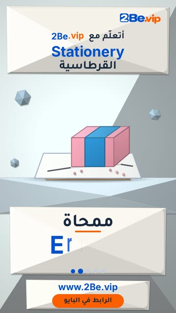

# EP61 — Stationery

Part of **[Origami Reels](../README.md)**.

[](https://github.com/waseemRIT/2be-vip-content/releases/download/media-origami-reels/EP61_Stationery.mp4)

▶️ **[Watch / download the video](https://github.com/waseemRIT/2be-vip-content/releases/download/media-origami-reels/EP61_Stationery.mp4)** (0:29, 4 MB)

## Caption

```text
Stationery | القرطاسية — 5 English words 🎨
Notebook = دفتر · Eraser = ممحاة · Pen = قلم · Crayon = قلم تلوين · Sharpener = مبراة

تعلّم الإنجليزي مع 2Be.vip — الرابط في البايو 🔗
Learn English with 2Be.vip — link in bio

Music: "Bama Country" Kevin MacLeod (incompetech.com) — CC BY 4.0

#2Be #2BeVIP #تعلم_الانجليزي #LearnEnglish #English
```

---

<div dir="rtl">

# الحلقة 61 — Stationery

جزء من **[ريلز الأوريغامي](../README.md)**.

[](https://github.com/waseemRIT/2be-vip-content/releases/download/media-origami-reels/EP61_Stationery.mp4)

▶️ **[شاهد / حمّل الفيديو](https://github.com/waseemRIT/2be-vip-content/releases/download/media-origami-reels/EP61_Stationery.mp4)** (0:29، 4 ميجابايت)

## الكابشن

```text
Stationery | القرطاسية — 5 English words 🎨
Notebook = دفتر · Eraser = ممحاة · Pen = قلم · Crayon = قلم تلوين · Sharpener = مبراة

تعلّم الإنجليزي مع 2Be.vip — الرابط في البايو 🔗
Learn English with 2Be.vip — link in bio

Music: "Bama Country" Kevin MacLeod (incompetech.com) — CC BY 4.0

#2Be #2BeVIP #تعلم_الانجليزي #LearnEnglish #English
```

</div>
