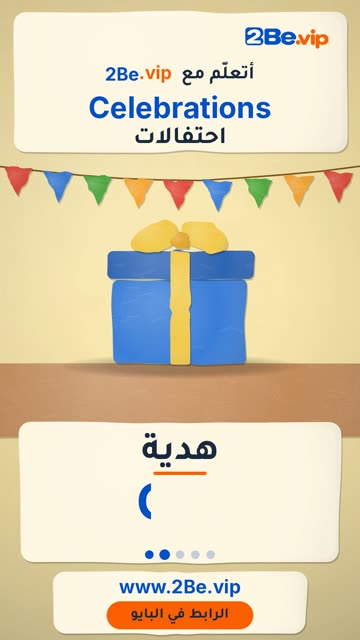

# EP01 — Celebrations

Part of **[Papier-mache Reels](../README.md)**.

[](https://github.com/waseemRIT/2be-vip-content/releases/download/media-papiermache-reels/EP01_Celebrations.mp4)

▶️ **[Watch / download the video](https://github.com/waseemRIT/2be-vip-content/releases/download/media-papiermache-reels/EP01_Celebrations.mp4)** (0:29, 5 MB)

## Caption

```text
Celebrations | احتفالات — 5 English words 🎨
Cake = كعكة · Gift = هدية · Candle = شمعة · Lantern = فانوس · Drum = طبل

تعلّم الإنجليزي مع 2Be.vip — الرابط في البايو 🔗
Learn English with 2Be.vip — link in bio

Music: "Hyperfun" Kevin MacLeod (incompetech.com) — CC BY 4.0

#2Be #2BeVIP #تعلم_الانجليزي #LearnEnglish #English
```

---

<div dir="rtl">

# الحلقة 01 — Celebrations

جزء من **[ريلز ورق الجرائد المعجون](../README.md)**.

[](https://github.com/waseemRIT/2be-vip-content/releases/download/media-papiermache-reels/EP01_Celebrations.mp4)

▶️ **[شاهد / حمّل الفيديو](https://github.com/waseemRIT/2be-vip-content/releases/download/media-papiermache-reels/EP01_Celebrations.mp4)** (0:29، 5 ميجابايت)

## الكابشن

```text
Celebrations | احتفالات — 5 English words 🎨
Cake = كعكة · Gift = هدية · Candle = شمعة · Lantern = فانوس · Drum = طبل

تعلّم الإنجليزي مع 2Be.vip — الرابط في البايو 🔗
Learn English with 2Be.vip — link in bio

Music: "Hyperfun" Kevin MacLeod (incompetech.com) — CC BY 4.0

#2Be #2BeVIP #تعلم_الانجليزي #LearnEnglish #English
```

</div>
