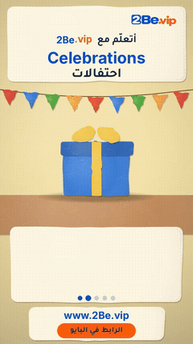

# Papier-mache Reels

Handmade papier-mache objects are built piece by piece while the English word is painted on.

**3 posts.** Click a thumbnail to open the post (video, caption and download link).

<table>
<tr><td align="center" valign="top"><a href="EP01%20Celebrations/"> EP01 · Celebrations</a></td><td align="center" valign="top"><a href="EP02%20Fruits/"> EP02 · Fruits</a></td><td align="center" valign="top"><a href="EP03%20Sweets/"> EP03 · Sweets</a></td></tr>
</table>

---

# ريلز ورق الجرائد المعجون

أشياء مصنوعة يدوياً من ورق الجرائد تُبنى قطعة قطعة، مع الكلمة الإنجليزية ونطقها بالحروف العربية.

**3 منشور.** اضغط على أي صورة لفتح المنشور (الفيديو والكابشن ورابط التحميل).

<table>
<tr><td align="center" valign="top"><a href="EP01%20Celebrations/"> الحلقة 01 · Celebrations</a></td><td align="center" valign="top"><a href="EP02%20Fruits/"> الحلقة 02 · Fruits</a></td><td align="center" valign="top"><a href="EP03%20Sweets/"> الحلقة 03 · Sweets</a></td></tr>
</table>

