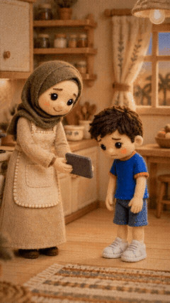

# 2Be with the Sami Family

Felt-animation family stories (Gulf Arabic) about everyday moments where English makes the difference.

**2 posts.** Click a thumbnail to open the post (video, caption and download link).

<table>
<tr><td align="center" valign="top"><a href="EP02%20The%20Recipe/"> EP02 · The Recipe</a></td><td align="center" valign="top"><a href="EP03%20The%20Dream/"> EP03 · The Dream</a></td></tr>
</table>

---

# 2Be مع عائلة سامي

قصص عائلية برسوم اللباد (باللهجة الخليجية) عن لحظات يومية يصنع فيها الإنجليزي الفرق.

**2 منشور.** اضغط على أي صورة لفتح المنشور (الفيديو والكابشن ورابط التحميل).

<table>
<tr><td align="center" valign="top"><a href="EP02%20The%20Recipe/"> الحلقة 02 · The Recipe</a></td><td align="center" valign="top"><a href="EP03%20The%20Dream/"> الحلقة 03 · The Dream</a></td></tr>
</table>

