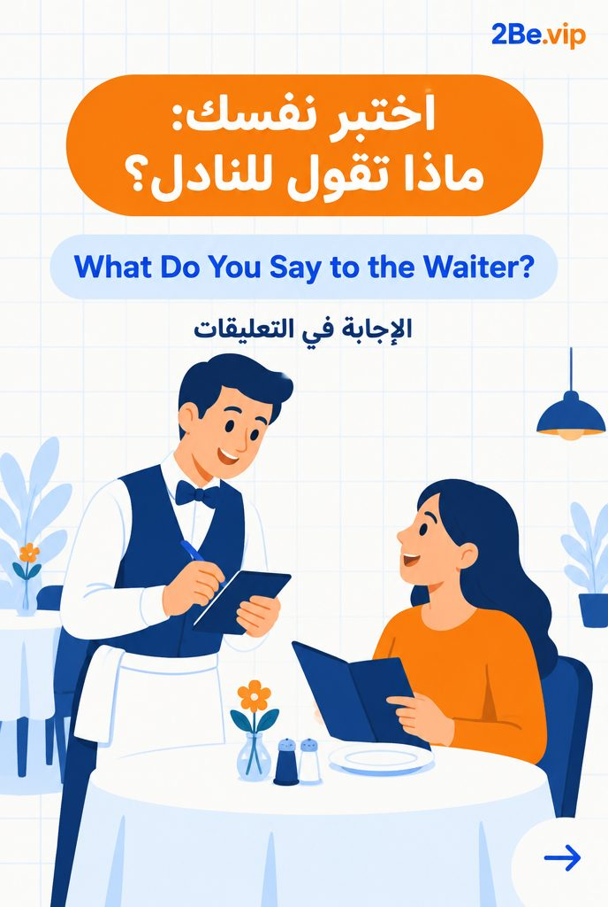
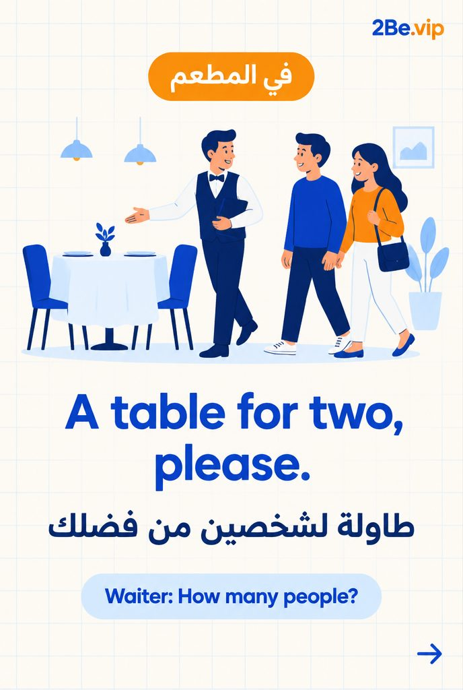
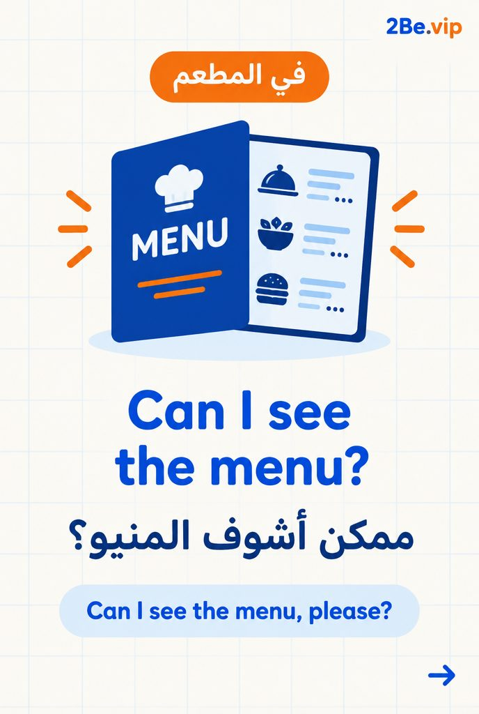
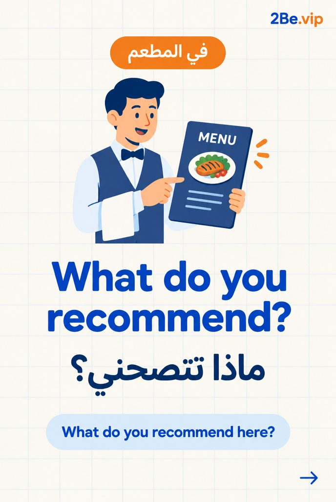
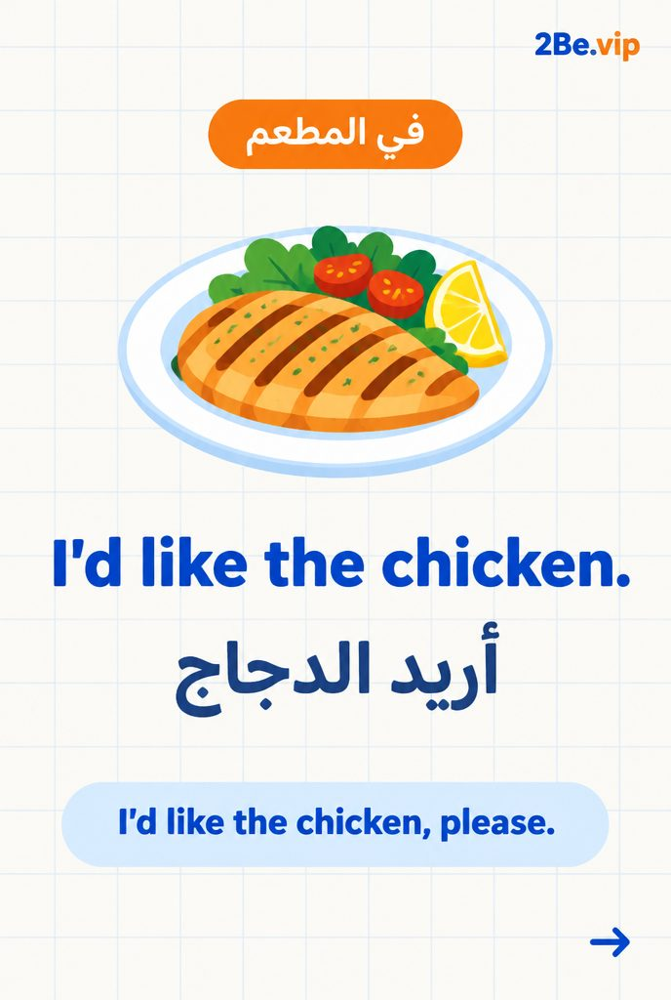
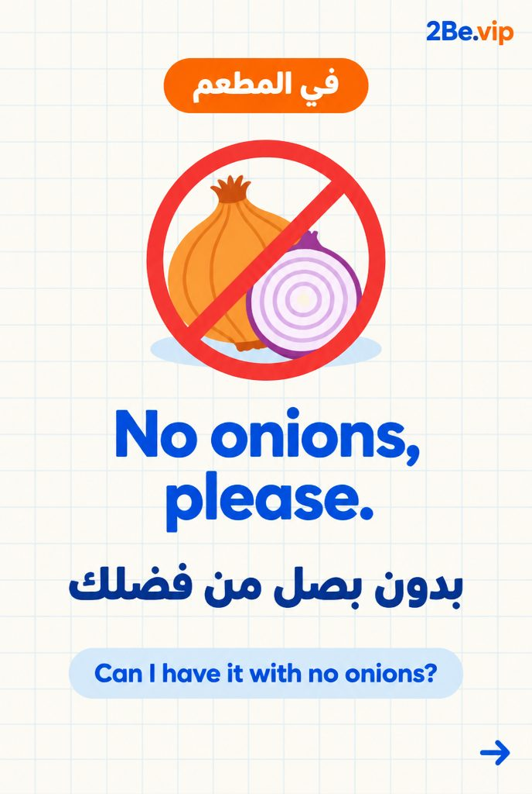
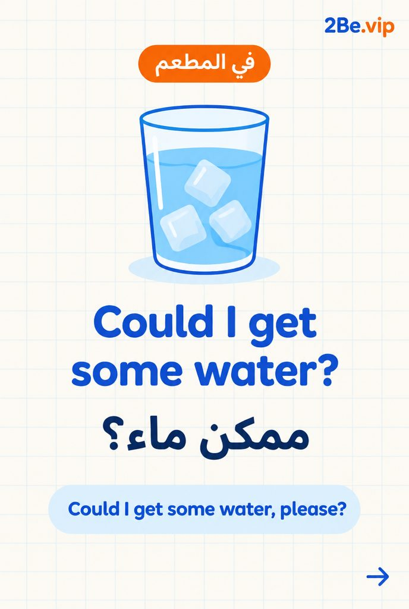
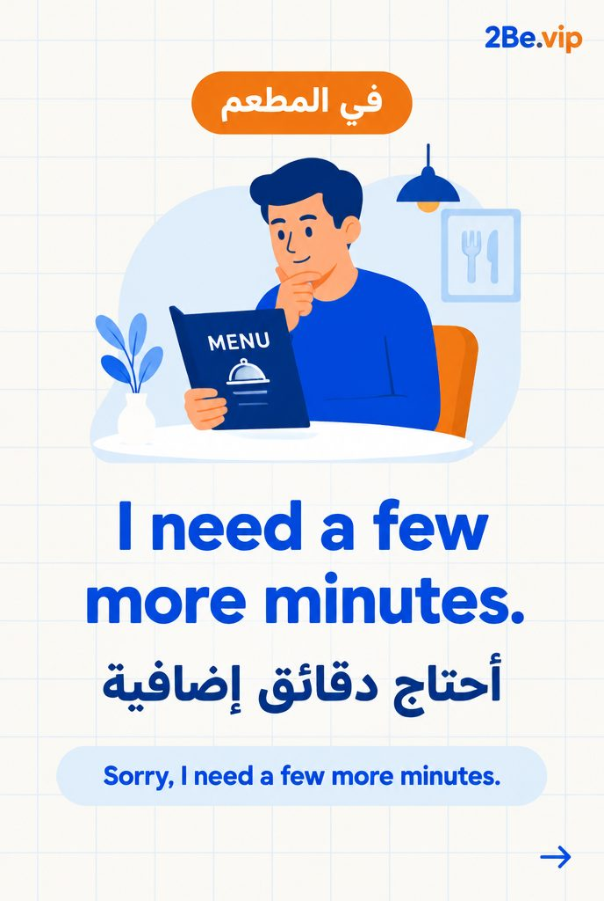
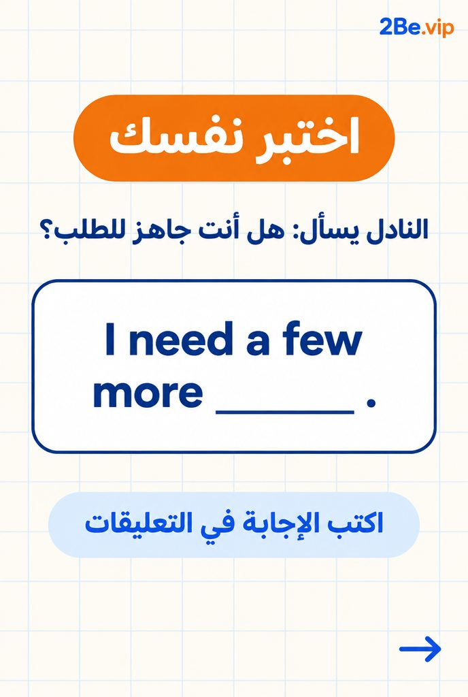

# EP34 — What to Say to the Waiter

Part of **[Slideshows](../README.md)**.

**10 slides** — swipe order:

         

## Caption

```text
What to Say to the Waiter | 2Be.vip

اسحب ← وتعلّم 👆
Swipeable carousel posts with everyday English tips, phrases and vocabulary.

تعلّم الإنجليزي مع 2Be.vip — الرابط في البايو 🔗
Learn English with 2Be.vip — link in bio

#2Be #2BeVIP #تعلم_الانجليزي #LearnEnglish #English
```

---

<div dir="rtl">

# الحلقة 34 — What to Say to the Waiter

جزء من **[شرائح العرض](../README.md)**.

**10 شرائح** — بترتيب السحب:

         

## الكابشن

```text
What to Say to the Waiter | 2Be.vip

اسحب ← وتعلّم 👆
Swipeable carousel posts with everyday English tips, phrases and vocabulary.

تعلّم الإنجليزي مع 2Be.vip — الرابط في البايو 🔗
Learn English with 2Be.vip — link in bio

#2Be #2BeVIP #تعلم_الانجليزي #LearnEnglish #English
```

</div>
