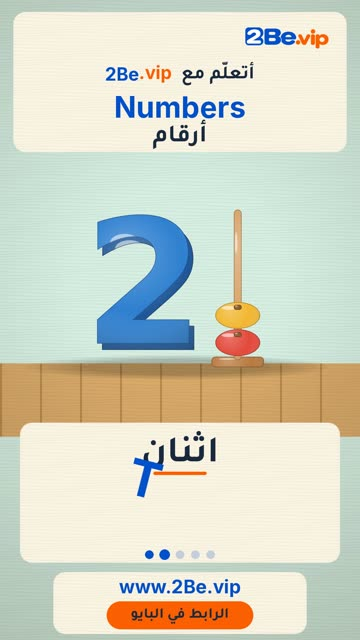

# EP11 — Numbers

Part of **[Wooden Toy Reels](../README.md)**.

[](https://github.com/waseemRIT/2be-vip-content/releases/download/media-woodtoy-reels/EP11_Numbers.mp4)

▶️ **[Watch / download the video](https://github.com/waseemRIT/2be-vip-content/releases/download/media-woodtoy-reels/EP11_Numbers.mp4)** (0:29, 3 MB)

## Caption

```text
Numbers | أرقام — 5 English words 🎨
One = واحد · Two = اثنان · Three = ثلاثة · Four = أربعة · Five = خمسة

تعلّم الإنجليزي مع 2Be.vip — الرابط في البايو 🔗
Learn English with 2Be.vip — link in bio

Music: "Hyperfun" Kevin MacLeod (incompetech.com) — CC BY 4.0

#2Be #2BeVIP #تعلم_الانجليزي #LearnEnglish #English
```

---

<div dir="rtl">

# الحلقة 11 — Numbers

جزء من **[ريلز الألعاب الخشبية](../README.md)**.

[](https://github.com/waseemRIT/2be-vip-content/releases/download/media-woodtoy-reels/EP11_Numbers.mp4)

▶️ **[شاهد / حمّل الفيديو](https://github.com/waseemRIT/2be-vip-content/releases/download/media-woodtoy-reels/EP11_Numbers.mp4)** (0:29، 3 ميجابايت)

## الكابشن

```text
Numbers | أرقام — 5 English words 🎨
One = واحد · Two = اثنان · Three = ثلاثة · Four = أربعة · Five = خمسة

تعلّم الإنجليزي مع 2Be.vip — الرابط في البايو 🔗
Learn English with 2Be.vip — link in bio

Music: "Hyperfun" Kevin MacLeod (incompetech.com) — CC BY 4.0

#2Be #2BeVIP #تعلم_الانجليزي #LearnEnglish #English
```

</div>
