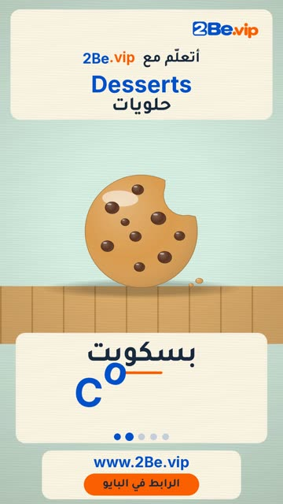

# EP20 — Desserts

Part of **[Wooden Toy Reels](../README.md)**.

[](https://github.com/waseemRIT/2be-vip-content/releases/download/media-woodtoy-reels/EP20_Desserts.mp4)

▶️ **[Watch / download the video](https://github.com/waseemRIT/2be-vip-content/releases/download/media-woodtoy-reels/EP20_Desserts.mp4)** (0:29, 3 MB)

## Caption

```text
Desserts | حلويات — 5 English words 🎨
Cake = كعكة · Cookie = بسكويت · Ice cream = مثلجات · Candy = حلوى · Donut = دونات

تعلّم الإنجليزي مع 2Be.vip — الرابط في البايو 🔗
Learn English with 2Be.vip — link in bio

Music: "Plucky Daisy" Kevin MacLeod (incompetech.com) — CC BY 4.0

#2Be #2BeVIP #تعلم_الانجليزي #LearnEnglish #English
```

---

<div dir="rtl">

# الحلقة 20 — Desserts

جزء من **[ريلز الألعاب الخشبية](../README.md)**.

[](https://github.com/waseemRIT/2be-vip-content/releases/download/media-woodtoy-reels/EP20_Desserts.mp4)

▶️ **[شاهد / حمّل الفيديو](https://github.com/waseemRIT/2be-vip-content/releases/download/media-woodtoy-reels/EP20_Desserts.mp4)** (0:29، 3 ميجابايت)

## الكابشن

```text
Desserts | حلويات — 5 English words 🎨
Cake = كعكة · Cookie = بسكويت · Ice cream = مثلجات · Candy = حلوى · Donut = دونات

تعلّم الإنجليزي مع 2Be.vip — الرابط في البايو 🔗
Learn English with 2Be.vip — link in bio

Music: "Plucky Daisy" Kevin MacLeod (incompetech.com) — CC BY 4.0

#2Be #2BeVIP #تعلم_الانجليزي #LearnEnglish #English
```

</div>
