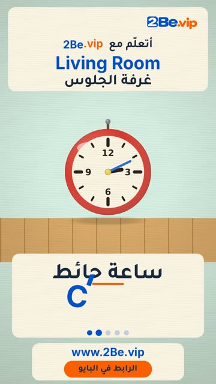

# EP26 — Living Room

Part of **[Wooden Toy Reels](../README.md)**.

[](https://github.com/waseemRIT/2be-vip-content/releases/download/media-woodtoy-reels/EP26_Living_Room.mp4)

▶️ **[Watch / download the video](https://github.com/waseemRIT/2be-vip-content/releases/download/media-woodtoy-reels/EP26_Living_Room.mp4)** (0:29, 3 MB)

## Caption

```text
Living Room | غرفة الجلوس — 5 English words 🎨
Television = تلفاز · Clock = ساعة حائط · Rug = سجادة · Curtain = ستارة · Cushion = وسادة

تعلّم الإنجليزي مع 2Be.vip — الرابط في البايو 🔗
Learn English with 2Be.vip — link in bio

Music: "Chipper Doodle v2" Kevin MacLeod (incompetech.com) — CC BY 4.0

#2Be #2BeVIP #تعلم_الانجليزي #LearnEnglish #English
```

---

<div dir="rtl">

# الحلقة 26 — Living Room

جزء من **[ريلز الألعاب الخشبية](../README.md)**.

[](https://github.com/waseemRIT/2be-vip-content/releases/download/media-woodtoy-reels/EP26_Living_Room.mp4)

▶️ **[شاهد / حمّل الفيديو](https://github.com/waseemRIT/2be-vip-content/releases/download/media-woodtoy-reels/EP26_Living_Room.mp4)** (0:29، 3 ميجابايت)

## الكابشن

```text
Living Room | غرفة الجلوس — 5 English words 🎨
Television = تلفاز · Clock = ساعة حائط · Rug = سجادة · Curtain = ستارة · Cushion = وسادة

تعلّم الإنجليزي مع 2Be.vip — الرابط في البايو 🔗
Learn English with 2Be.vip — link in bio

Music: "Chipper Doodle v2" Kevin MacLeod (incompetech.com) — CC BY 4.0

#2Be #2BeVIP #تعلم_الانجليزي #LearnEnglish #English
```

</div>
