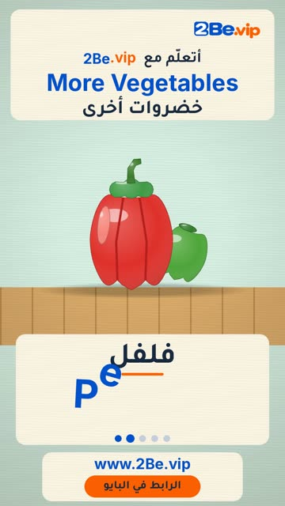

# EP38 — More Vegetables

Part of **[Wooden Toy Reels](../README.md)**.

[](https://github.com/waseemRIT/2be-vip-content/releases/download/media-woodtoy-reels/EP38_More_Vegetables.mp4)

▶️ **[Watch / download the video](https://github.com/waseemRIT/2be-vip-content/releases/download/media-woodtoy-reels/EP38_More_Vegetables.mp4)** (0:29, 4 MB)

## Caption

```text
More Vegetables | خضروات أخرى — 5 English words 🎨
Corn = ذرة · Pepper = فلفل · Eggplant = باذنجان · Broccoli = بروكلي · Pumpkin = يقطين

تعلّم الإنجليزي مع 2Be.vip — الرابط في البايو 🔗
Learn English with 2Be.vip — link in bio

Music: "Corncob" Kevin MacLeod (incompetech.com) — CC BY 4.0

#2Be #2BeVIP #تعلم_الانجليزي #LearnEnglish #English
```

---

<div dir="rtl">

# الحلقة 38 — More Vegetables

جزء من **[ريلز الألعاب الخشبية](../README.md)**.

[](https://github.com/waseemRIT/2be-vip-content/releases/download/media-woodtoy-reels/EP38_More_Vegetables.mp4)

▶️ **[شاهد / حمّل الفيديو](https://github.com/waseemRIT/2be-vip-content/releases/download/media-woodtoy-reels/EP38_More_Vegetables.mp4)** (0:29، 4 ميجابايت)

## الكابشن

```text
More Vegetables | خضروات أخرى — 5 English words 🎨
Corn = ذرة · Pepper = فلفل · Eggplant = باذنجان · Broccoli = بروكلي · Pumpkin = يقطين

تعلّم الإنجليزي مع 2Be.vip — الرابط في البايو 🔗
Learn English with 2Be.vip — link in bio

Music: "Corncob" Kevin MacLeod (incompetech.com) — CC BY 4.0

#2Be #2BeVIP #تعلم_الانجليزي #LearnEnglish #English
```

</div>
