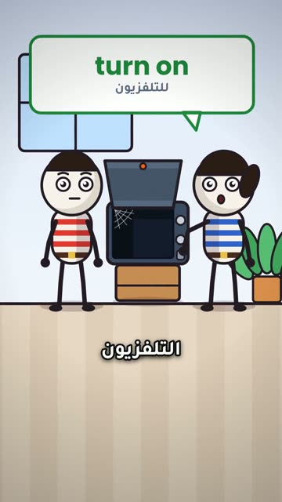

# EP04 — Turn On The TV

Part of **[2Be with Youssef — Mistake Fixes](../README.md)**.

[](https://github.com/waseemRIT/2be-vip-content/releases/download/media-youssef-stick-figures/EP04_Turn_On_The_TV.mp4)

▶️ **[Watch / download the video](https://github.com/waseemRIT/2be-vip-content/releases/download/media-youssef-stick-figures/EP04_Turn_On_The_TV.mp4)** (0:31, 4 MB)

## Caption

```text
Turn On The TV | 2Be.vip

غلطة إنجليزي شائعة… وإزاي نصلّحها ✍️
Stick-figure family scenes (Egyptian Arabic): one common English mistake, said wrong, struck out and fixed.

تعلّم الإنجليزي مع 2Be.vip — الرابط في البايو 🔗
Learn English with 2Be.vip — link in bio

#2Be #2BeVIP #تعلم_الانجليزي #LearnEnglish #English
```

---

<div dir="rtl">

# الحلقة 04 — Turn On The TV

جزء من **[2Be مع يوسف — تصحيح الأخطاء](../README.md)**.

[](https://github.com/waseemRIT/2be-vip-content/releases/download/media-youssef-stick-figures/EP04_Turn_On_The_TV.mp4)

▶️ **[شاهد / حمّل الفيديو](https://github.com/waseemRIT/2be-vip-content/releases/download/media-youssef-stick-figures/EP04_Turn_On_The_TV.mp4)** (0:31، 4 ميجابايت)

## الكابشن

```text
Turn On The TV | 2Be.vip

غلطة إنجليزي شائعة… وإزاي نصلّحها ✍️
Stick-figure family scenes (Egyptian Arabic): one common English mistake, said wrong, struck out and fixed.

تعلّم الإنجليزي مع 2Be.vip — الرابط في البايو 🔗
Learn English with 2Be.vip — link in bio

#2Be #2BeVIP #تعلم_الانجليزي #LearnEnglish #English
```

</div>
