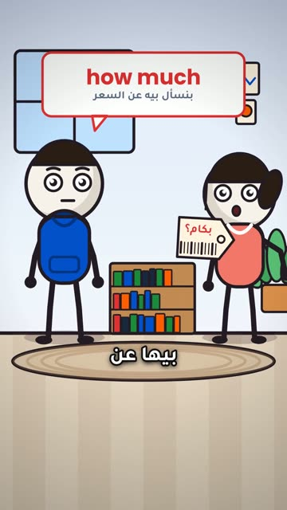

# EP07 — How Old Are You

Part of **[2Be with Youssef — Mistake Fixes](../README.md)**.

[](https://github.com/waseemRIT/2be-vip-content/releases/download/media-youssef-stick-figures/EP07_How_Old_Are_You.mp4)

▶️ **[Watch / download the video](https://github.com/waseemRIT/2be-vip-content/releases/download/media-youssef-stick-figures/EP07_How_Old_Are_You.mp4)** (0:33, 5 MB)

## Caption

```text
How Old Are You | 2Be.vip

غلطة إنجليزي شائعة… وإزاي نصلّحها ✍️
Stick-figure family scenes (Egyptian Arabic): one common English mistake, said wrong, struck out and fixed.

تعلّم الإنجليزي مع 2Be.vip — الرابط في البايو 🔗
Learn English with 2Be.vip — link in bio

#2Be #2BeVIP #تعلم_الانجليزي #LearnEnglish #English
```

---

<div dir="rtl">

# الحلقة 07 — How Old Are You

جزء من **[2Be مع يوسف — تصحيح الأخطاء](../README.md)**.

[](https://github.com/waseemRIT/2be-vip-content/releases/download/media-youssef-stick-figures/EP07_How_Old_Are_You.mp4)

▶️ **[شاهد / حمّل الفيديو](https://github.com/waseemRIT/2be-vip-content/releases/download/media-youssef-stick-figures/EP07_How_Old_Are_You.mp4)** (0:33، 5 ميجابايت)

## الكابشن

```text
How Old Are You | 2Be.vip

غلطة إنجليزي شائعة… وإزاي نصلّحها ✍️
Stick-figure family scenes (Egyptian Arabic): one common English mistake, said wrong, struck out and fixed.

تعلّم الإنجليزي مع 2Be.vip — الرابط في البايو 🔗
Learn English with 2Be.vip — link in bio

#2Be #2BeVIP #تعلم_الانجليزي #LearnEnglish #English
```

</div>
