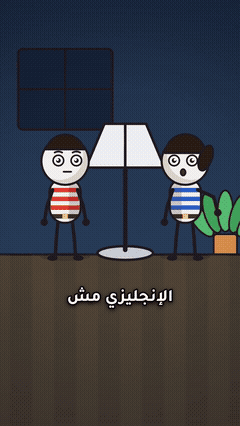

# 2Be with Youssef — Mistake Fixes

Stick-figure family scenes (Egyptian Arabic): one common English mistake, said wrong, struck out and fixed.

**7 posts.** Click a thumbnail to open the post (video, caption and download link).

<table>
<tr><td align="center" valign="top"><a href="EP01%20Open%20The%20Light/"> EP01 · Open The Light</a></td><td align="center" valign="top"><a href="EP02%20My%20Phone%20Is%20Off/"> EP02 · My Phone Is Off</a></td><td align="center" valign="top"><a href="EP03%20I%20Am%20Bored/"> EP03 · I Am Bored</a></td><td align="center" valign="top"><a href="EP04%20Turn%20On%20The%20TV/"> EP04 · Turn On The TV</a></td></tr>
<tr><td align="center" valign="top"><a href="EP05%20I%20Agree/"> EP05 · I Agree</a></td><td align="center" valign="top"><a href="EP06%20Teach%20Me%20English/"> EP06 · Teach Me English</a></td><td align="center" valign="top"><a href="EP07%20How%20Old%20Are%20You/"> EP07 · How Old Are You</a></td></tr>
</table>

---

# 2Be مع يوسف — تصحيح الأخطاء

مشاهد عائلية برسوم بسيطة (بالعامية المصرية): غلطة إنجليزية شائعة، تُقال غلط، ثم تُشطب وتُصحَّح.

**7 منشور.** اضغط على أي صورة لفتح المنشور (الفيديو والكابشن ورابط التحميل).

<table>
<tr><td align="center" valign="top"><a href="EP01%20Open%20The%20Light/"> الحلقة 01 · Open The Light</a></td><td align="center" valign="top"><a href="EP02%20My%20Phone%20Is%20Off/"> الحلقة 02 · My Phone Is Off</a></td><td align="center" valign="top"><a href="EP03%20I%20Am%20Bored/"> الحلقة 03 · I Am Bored</a></td><td align="center" valign="top"><a href="EP04%20Turn%20On%20The%20TV/"> الحلقة 04 · Turn On The TV</a></td></tr>
<tr><td align="center" valign="top"><a href="EP05%20I%20Agree/"> الحلقة 05 · I Agree</a></td><td align="center" valign="top"><a href="EP06%20Teach%20Me%20English/"> الحلقة 06 · Teach Me English</a></td><td align="center" valign="top"><a href="EP07%20How%20Old%20Are%20You/"> الحلقة 07 · How Old Are You</a></td></tr>
</table>

